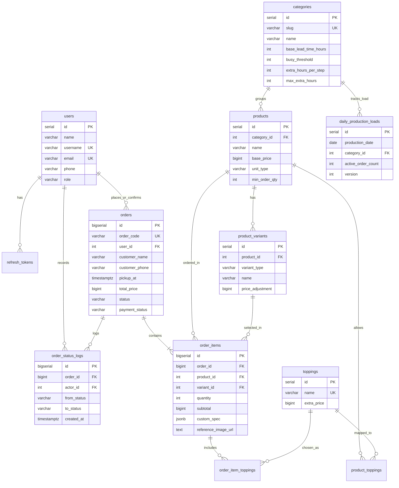

# BakeOrder — Sistem Pemesanan Toko Kue Made-to-Order

> **Repositori Public:** https://github.com/Tullannghoda/UAS_PBL_K1.git  
> **Rincian Teknis Lengkap:** Lihat [`project.md`](./project.md)

## Deskripsi Sistem
**BakeOrder** adalah backend REST API berbasis Go untuk toko kue dengan sistem **made-to-order (pre-order)**. Toko tidak menyediakan stok kue siap ambil di lemari etalase; seluruh pesanan dibuat baru sesuai antrean yang masuk secara online maupun langsung di tempat (*walk-in*) melalui kasir.

Sistem membagi kue ke dalam 5 kategori (**Kue Ulang Tahun**, **Kue Bolu**, **Kue Ulang Tahun Lainnya**, **Kue Basah**, dan **Kue Kering**) dengan dukungan kustomisasi rasa, ukuran loyang/berat toples (`1/2 kg` & `1 kg`), pilihan topping, minimal jumlah order kue basah, upload foto referensi desain kue ulang tahun, serta konfirmasi pembayaran manual oleh kasir. Untuk menjaga ketepatan waktu produksi, sistem menerapkan **Smart Dynamic Lead Time**: waktu ambil minimal otomatis bertambah ketika antrean pesanan pada tanggal tertentu sedang padat (misalnya Kue Ulang Tahun dari minimal **4 jam** otomatis menjadi **5 jam**, Kue Basah minimal **H-1 / 1 hari**, dan Kue Kering minimal **H-14 / 2 minggu**).

---

## Anggota Kelompok & Perannya

Kelompok terdiri dari **3 orang**:

| No | NIM | Anggota | Pengalaman | Peran Utama | Tanggung Jawab |
| --- | --- | --- | --- | --- | --- |
| 1 | `434241044` | **Glennovian Benhur United Lumbantoruann** | Masih belajar Go | **Git Master + Fondasi, Auth/RBAC & Notifikasi** | Setup repo, branch protection, review & merge PR, scaffold core, Auth JWT & RBAC (Modul 5–6), Outbox & Redis/Asynq Worker (Modul 11) |
| 2 | `434241032` | **Alisya Aninda Safwa** | Masih belajar Go | **Helper, Katalog Kue, MongoDB & Swagger** | `AppError` & centralized `ErrorHandler`, SQL seeder & endpoint read Katalog (Modul 2–4, 7), Ulasan MongoDB (Modul 10), dokumentasi Swagger (Modul 12) |
| 3 | `434231032` | **Mellinda Impiawati** | Masih belajar Go | **TxManager, Pesanan & Smart Lead Time, Test & Docker** | `DBTX` & `TxManager`, modul Pesanan + Smart Lead Time + konfirmasi bayar kasir (Modul 9), unit & integration test serta Docker Compose (Modul 12) |

---

## Role pada Sistem

| Role | Hak Akses Utama |
| --- | --- |
| **Admin** (`admin`) | Akses penuh terhadap monitoring operasional, antrean pesanan, konfirmasi status/pembayaran, dan manajemen sistem |
| **Staff / Kasir** (`staff`) | Input pesanan *walk-in* di toko, melihat daftar seluruh antrean pesanan, meninjau foto referensi desain, memperbarui status produksi pesanan, dan mencatat konfirmasi pembayaran manual (`unpaid` / `dp_paid` / `paid`) |
| **Pelanggan** (`customer`) | Registrasi & login, melihat kategori & produk kue, mengecek estimasi harga dan waktu pengambilan dinamis, membuat pesanan (termasuk upload foto referensi), melihat riwayat pesanan & notifikasi, membatalkan pesanan saat `pending`, serta menulis ulasan produk |

---

## Daftar Fitur Utama (Cakupan Inti Modul 1–12)

Cakupan endpoint difokuskan pada **15 endpoint inti** (`/api/v1`) dengan data master katalog diisi melalui SQL seeder di migrasi:

| No | Fitur | Role | Modul Terkait |
| --- | --- | --- | --- |
| 1 | Health check dual-database (`GET /health` PostgreSQL & MongoDB) | Publik | Modul 1, 3, 10 |
| 2 | Registrasi, login dengan rate limiter, dan rotasi refresh token | Semua | Modul 2, 5, 6 |
| 3 | Melihat kategori kue & aturan waktu pembuatan dasar (`GET /categories`) | Publik | Modul 3, 4 |
| 4 | Melihat daftar produk kue, varian, topping valid, dan minimal order dengan filter & cursor pagination (`GET /products`) | Publik | Modul 3, 4, 7 |
| 5 | Estimasi total harga & waktu pengambilan tercepat dinamis (`POST /orders/estimate`) | Customer, Staff | Modul 4 (Pure Rules) |
| 6 | Membuat pesanan *made-to-order* + upload referensi desain & kunci antrean atomik (`POST /orders`) | Customer, Staff | Modul 2, 9, 11 |
| 7 | Melihat riwayat pesanan milik pelanggan (`GET /orders/mine`) | Customer | Modul 6 |
| 8 | Melihat daftar seluruh antrean pesanan untuk dapur/kasir (`GET /orders`) | Staff, Admin | Modul 6, 7 |
| 9 | Memperbarui status pesanan (`confirmed` -> `in_production` -> `ready` -> `completed` / `rejected`) beserta log audit (`PATCH /orders/:id/status`) | Staff, Admin | Modul 6, 9, 11 |
| 10 | Mencatat konfirmasi pembayaran manual di kasir (`PATCH /orders/:id/payment`) | Staff, Admin | Modul 6, 9 |
| 11 | Membatalkan pesanan saat masih `pending` dan mengembalikan beban antrean (`POST /orders/:id/cancel`) | Customer | Modul 9, 11 |
| 12 | Menulis & melihat ulasan kue pada MongoDB (`POST` & `GET /products/:id/reviews`) | Customer, Publik | Modul 10 |
| 13 | Melihat notifikasi status pesanan asinkron hasil proses Redis/Asynq Worker (`GET /notifications/mine`) | Customer | Modul 11 |
| 14 | Dokumentasi API interaktif Swagger UI, Unit & Integration Test, dan containerisasi Docker Compose | Tim Pengembang | Modul 12 |

---

## Rancangan Database

Database utama menggunakan **PostgreSQL** untuk data transaksional dan konsistensi antrean, dipadukan dengan **MongoDB** untuk ulasan produk serta **Redis** untuk antrean background worker.

### Tabel Utama PostgreSQL & Koleksi MongoDB

| Penyimpanan | Tabel / Koleksi | Kolom Utama | Relasi & Keterangan |
| --- | --- | --- | --- |
| PostgreSQL | `users`, `refresh_tokens`, `roles`, `permissions`, `role_permissions` | `id`, `name`, `username`, `email`, `password_hash`, `phone`, `role`, `is_active` | Autentikasi JWT & RBAC (`admin`, `staff`, `customer`) |
| PostgreSQL | `categories` | `id`, `slug`, `name`, `base_lead_time_hours`, `busy_threshold`, `extra_hours_per_step`, `max_extra_hours`, `allows_custom_design`, `allows_reference_image` | 5 kategori kue beserta parameter Smart Dynamic Lead Time |
| PostgreSQL | `products` | `id`, `category_id`, `name`, `base_price`, `unit_type`, `min_order_qty`, `is_active` | Milik satu `categories`; tanpa stok, memakai `min_order_qty` |
| PostgreSQL | `product_variants` | `id`, `product_id`, `variant_type`, `name`, `price_adjustment` | Rasa bolu (7 rasa), ukuran tart, atau toples (`1/2 kg`, `1 kg`) |
| PostgreSQL | `toppings`, `product_toppings` | `id`, `name`, `extra_price` / `product_id`, `topping_id` | Master topping & pembatasan topping per produk |
| PostgreSQL | `daily_production_loads` | `id`, `production_date`, `category_id`, `active_order_count`, `max_daily_orders`, `version` | Mengukur kepadatan harian dan dikunci dengan `FOR UPDATE` saat pesan |
| PostgreSQL | `orders` | `id`, `order_code`, `user_id`, `customer_name`, `customer_phone`, `order_channel`, `pickup_at`, `earliest_pickup_snapshot`, `total_price`, `status`, `payment_status`, `payment_method`, `paid_amount`, `paid_at` | Data pemesan, jadwal ambil, status pesanan & pembayaran manual |
| PostgreSQL | `order_items`, `order_item_toppings` | `id`, `order_id`, `product_id`, `variant_id`, `quantity`, `unit_price`, `subtotal`, `custom_spec` (`JSONB`), `reference_image_url` | Item pesanan, kustomisasi bentuk/warna/ucapan, referensi foto, dan topping |
| PostgreSQL | `order_status_logs` | `id`, `order_id`, `actor_id`, `from_status`, `to_status`, `note`, `created_at` | Riwayat perubahan status pesanan & pembayaran |
| PostgreSQL | `outbox`, `notifications` | `id`, `event_type`, `payload`, `published_at` / `id`, `outbox_id`, `user_id`, `subject`, `body`, `sent_at` | Transactional Outbox untuk pengiriman notifikasi asinkron via Redis/Asynq |
| MongoDB | `product_reviews` | `_id`, `product_id`, `user_id`, `username`, `rating`, `comment`, `tags`, `created_at` | Ulasan produk per pelanggan (unique index `product_id + user_id`) |

- **Status Pesanan (`orders.status`):** `pending`, `confirmed`, `in_production`, `ready`, `completed`, `rejected`, `cancelled`
- **Status Pembayaran (`orders.payment_status`):** `unpaid`, `dp_paid`, `paid`

### Diagram ERD



---

## Struktur Proyek (Clean Architecture)

Struktur proyek mengikuti konvensi Clean Architecture pada modul praktikum dan **tidak menggunakan istilah atau layer `controller` maupun `handler`**:

```text
UAS_KEL1_PBL/
├── app/
│   ├── model/          # Struct domain, request DTO, response DTO
│   ├── repository/     # Interface & implementasi akses data PostgreSQL (DBTX) + MongoDB
│   └── service/        # Aturan bisnis murni (*_rules.go), endpoint service (*_service.go), relay & worker
├── config/             # Loader .env, slog logger, queue Asynq, Fiber app & ErrorHandler
├── database/           # Pool koneksi PostgreSQL & client MongoDB
├── docs/               # Spesifikasi OpenAPI / Swagger
├── helper/             # JWTManager, bcrypt, validator, AppError, response, cursor, upload
├── middleware/         # RequestID, logging, CORS, RequireJSON, RequireAuth, RequirePermission
├── migrations/         # Skema SQL & seeder awal berurutan
├── route/              # Registrasi endpoint Fiber & dependency injection
├── tests/integration/  # Integration test dengan tag //go:build integration
├── .env.example
├── .gitignore
├── Dockerfile
├── docker-compose.yml
├── go.mod
├── main.go
├── project.md          # Spesifikasi teknis rinci
└── README.md
```

---

## Alur Kerja GitHub & Micro Commits

1. Branch `main` dilindungi (**Branch Protection**); tidak ada commit atau push langsung ke `main`.
2. Setiap anggota membuat branch baru dari `main` terbaru sesuai tugas masing-masing (rincian daftar branch ada di [`project.md`](./project.md)).
3. Gunakan **micro commits** dengan format `type(scope): pesan` (contoh: `feat(model): add Order struct`, `feat(service): calculate dynamic lead time`).
4. Perubahan masuk ke `main` hanya melalui **Pull Request** yang di-review dan di-merge oleh **Git Master** memakai **Create a merge commit** (bukan *Squash*).
5. File `.env`, `logs/`, dan `uploads/` tidak boleh ikut ter-commit.

---

## Cara Menjalankan Proyek *(Setelah Tahap Implementasi Kode)*

```bash
# 1. Salin konfigurasi contoh
cp .env.example .env

# 2. Jalankan PostgreSQL, MongoDB, Redis, API, dan Worker via Docker Compose
docker compose up -d --build

# 3. Atau jalankan lokal dengan Go
go run . -role=all
```
