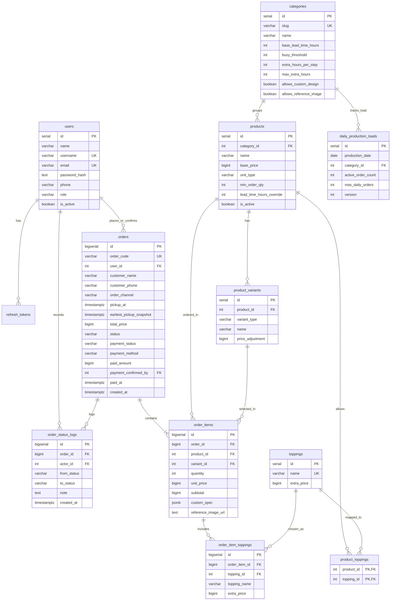

# Rancangan Sistem: Sistem Pemesanan Toko Kue Made-to-Order (Pre-Order)

> **Status Dokumen:** Progres Awal Rancangan Sistem (Kelompok 1 - Praktikum Pemrograman Backend Lanjut, Semester 5)  
> **Repositori GitHub:** https://github.com/Tullannghoda/UAS_PBL_K1.git  
> **Target Penyelesaian Penuh:** Ujian Akhir Semester (UAS)

---

## 1. Informasi Kelompok & Pembagian Peran (3 Anggota)

> Nama lengkap, NIM, dan username GitHub akan dilengkapi sebelum pengumpulan final.

| No | Anggota | Pengalaman | Peran Utama | Tanggung Jawab Modul & Branch |
| --- | --- | --- | --- | --- |
| 1 | Orang 1 *(nama & NIM menyusul)* | Terbiasa Go & Git | Git Master + Fondasi, Auth & RBAC | Setup repo public & branch protection, review & merge PR, scaffold core (`config`, `database`, `health`, `main`), Auth/RBAC (`CurrentUser`, `RequireAuth`, `RequirePermission`), dan notifikasi outbox (tahap UAS) |
| 2 | Orang 2 *(nama & NIM menyusul)* | Pernah membuat REST API | Helper + Katalog 5 Kategori Kue | `AppError`, helper response, validator, `ErrorHandler`, serta modul Katalog Kue utuh (migrations, model, repository, service, route) dan setup Swagger (tahap UAS) |
| 3 | Orang 3 *(nama & NIM menyusul)* | Sedang belajar Go | TxManager + Docs + Pesanan & Smart Lead Time | `DBTX` & `TxManager`, dokumentasi (`README.md`, ERD, role matrix), modul Pesanan Made-to-Order + Smart Dynamic Lead Time + upload referensi + konfirmasi pembayaran kasir, serta Docker & testing (tahap UAS) |

---

## 2. Profil Sistem

### 2.1 Nama Sistem
**BakeOrder** *(nama sementara, dapat disesuaikan kelompok)* - Sistem Pemesanan Toko Kue Made-to-Order dengan Estimasi Waktu Produksi Dinamis.

### 2.2 Deskripsi Sistem
Sistem ini melayani toko kue dengan model produksi **made-to-order (pre-order)**. Toko tidak menyediakan stok kue jadi di lemari etalase; seluruh kue dibuat berdasarkan **daftar antrean pesanan** yang masuk.

Pemesanan dapat dilakukan secara **online** oleh pelanggan maupun **di tempat (walk-in)** melalui kasir. Setiap pesanan mencatat **nama pemesan**, **nomor telepon**, **jadwal pengambilan (tanggal dan jam)**, serta rincian kustomisasi kue per kategori (termasuk upload foto referensi desain). Karena tidak berbasis stok, sistem menerapkan **Smart Dynamic Lead Time**: setiap kategori memiliki waktu pembuatan minimal berbeda, dan ketika antrean pesanan pada tanggal tertentu meningkat padat, sistem secara otomatis menambahkan waktu tunggu minimal pengambilan (misalnya Kue Ulang Tahun dari minimal 4 jam otomatis naik menjadi 5 jam).

### 2.3 Alur Pembayaran (Manual & Bayar di Tempat)
- Pembayaran tidak memakai payment gateway otomatis; pelanggan membayar **langsung di tempat** atau melalui **pembayaran manual** (tunai / transfer manual / QRIS toko) yang **dikonfirmasi manual oleh kasir/staff**.
- **Rekomendasi keamanan operasional (opsi DP manual):** Sistem memisahkan status pesanan (`orders.status`) dan status pembayaran (`orders.payment_status`: `unpaid`, `dp_paid`, `paid`). Untuk pesanan *walk-in* atau kue standar, pelanggan dapat melunasi saat pengambilan (`unpaid` -> `paid`). Untuk pesanan online kue kustom (Kue Ulang Tahun) atau pesanan jumlah besar (Kue Basah / Kue Kering), kasir dapat meminta DP manual (misal 30%-50%) dan menandai `dp_paid` sebelum dapur memulai produksi agar toko terlindungi dari pembatalan sepihak (*hit-and-run*).

---

## 3. Katalog Kategori, Produk, Minimal Order, & Lead Time Dasar

Sistem mengelompokkan produk ke dalam **5 kategori utama** tanpa kolom stok:

| No | Kategori (`slug`) | Daftar Produk | Varian / Kemasan | Aturan Kustomisasi | Lead Time Dasar |
| --- | --- | --- | --- | --- | --- |
| 1 | **Kue Ulang Tahun** (`birthday-cake`) | Kue Tart, Blackforest | Ukuran/diameter (16 cm, 20 cm, 24 cm) | Request warna, tema desain, bentuk, teks ucapan, dan **upload gambar referensi** | **4 jam** (dinamis +1 jam per ambang antrean padat) |
| 2 | **Kue Bolu** (`sponge-cake`) | Bolu Original, Pandan, Mocca, Marmer, Coklat, Pisang, Tape | 7 varian rasa, ukuran loyang | Opsional tambah topping di atas: **seres** atau **keju** | **4 jam** (dinamis saat padat) |
| 3 | **Kue Ulang Tahun Lainnya** (`other-birthday-cake`) | Bolu Petak, Brownies | Ukuran loyang / jumlah potong | Request topping, teks ucapan, desain sederhana, opsional upload referensi | **4 jam** (dinamis saat padat) |
| 4 | **Kue Basah** (`traditional-cake`) | Risol, Lapis, Donat, Dadar Gulung, Bolu Kukus, Kue Lumpur, Onde-Onde | Per buah (`piece`) | Wajib memenuhi **minimal jumlah pesanan (`min_order_qty`)** toko. Khusus **Donat** dapat memilih topping: **seres**, **coklat crumble**, **tepung gula**, dll. | **Minimal 1 hari sebelum** (`24 jam` / H-1) |
| 5 | **Kue Kering** (`cookies`) | Nastar, Kastengel, Semprit, Skippy, Putri Salju, Chocochips | Per toples (`jar`): **1/2 kg (500 g)** atau **1 kg (1000 g)** | Harga menyesuaikan ukuran toples (`1/2 kg` atau `1 kg`) | **Minimal 2 minggu sebelum** (`336 jam` / 14 hari / H-14) |

---

## 4. Mekanisme Smart Dynamic Lead Time (Penjadwalan Cerdas)

Karena tidak ada stok siap jual, kelayakan jadwal pengambilan (`pickup_at`) ditentukan dari kombinasi **lead time dasar kategori** dan **kepadatan antrean pesanan aktif** pada tanggal pengambilan yang dipilih.

### 4.1 Parameter Konfigurasi per Kategori (`categories`)
- `base_lead_time_hours`: waktu pembuatan minimal dalam kondisi normal (Kue Ultah/Bolu/Ultah Lainnya = `4`, Kue Basah = `24`, Kue Kering = `336`).
- `busy_threshold`: jumlah pesanan aktif pada tanggal & kategori yang sama sebelum sistem menaikkan waktu tunggu (misal Kue Ulang Tahun = `5` pesanan/hari).
- `extra_hours_per_step`: tambahan waktu (jam) untuk setiap kelipatan `busy_threshold` yang terlampaui (misal Kue Ulang Tahun = `1` jam; Kue Basah = `12` atau `24` jam).
- `max_extra_hours`: batas maksimal tambahan waktu dinamis (misal `4` jam untuk Kue Ulang Tahun).
- `max_daily_orders` *(opsional)*: batas atas pesanan harian per kategori bila dapur sudah penuh total.

### 4.2 Rumus Perhitungan (`CalculateEarliestPickup` di `app/service/order_rules.go`)
Untuk setiap item dalam pesanan pada tanggal pengambilan target `D`:
```text
step        = floor(active_order_count / busy_threshold)
extra_hours = min(step * extra_hours_per_step, max_extra_hours)
total_hours = base_lead_time_hours + extra_hours
earliest_i  = order_time + total_hours
```
Jika satu pesanan berisi lebih dari satu kategori (misalnya 1 Kue Tart + 20 Risol), sistem mengambil waktu paling lama:
```text
earliest_pickup_at = max(earliest_1, earliest_2, ..., earliest_n)
```

### 4.3 Contoh Skenario Nyata
1. **Kondisi Normal (Kue Ulang Tahun):**
   - Pelanggan memesan Kue Tart pukul `10:00`. Antrean aktif Kue Ulang Tahun hari ini berjumlah `2` (`< busy_threshold 5`).
   - `extra_hours = 0` -> minimal pengambilan = `10:00 + 4 jam = 14:00`.
2. **Kondisi Padat (Kue Ulang Tahun):**
   - Pelanggan memesan Kue Tart pukul `10:00`. Antrean aktif Kue Ulang Tahun hari ini sudah `6` (`>= 5` dan `< 10`).
   - `step = 1`, `extra_hours = +1 jam` -> sistem otomatis menaikkan minimal pengambilan dari **4 jam menjadi 5 jam** (`10:00 + 5 jam = 15:00`).
   - Bila pelanggan tetap mengirim `pickup_at = 14:00`, endpoint `POST /orders` menolak dengan `422 / 409 LEAD_TIME_EXCEEDED` disertai info `earliest_pickup_at = 15:00`.
3. **Kue Basah & Kue Kering:**
   - Memesan 20 pcs Risol pada tanggal 18 Nov pukul `10:00` -> minimal pengambilan **19 Nov pukul `10:00`** (H-1 / 24 jam).
   - Memesan 2 toples Nastar 1 kg pada tanggal 18 Nov -> minimal pengambilan **2 Desember** (H-14 / 2 minggu).

### 4.4 Keamanan Konkurensi (Database Transaction)
Saat dua pelanggan memesan bersamaan pada ambang batas antrean (misal pesanan ke-5 dan ke-6 masuk pada detik yang sama), transaksi `POST /orders` mengunci baris jadwal pada tabel `daily_production_loads` memakai `SELECT ... FOR UPDATE`, memvalidasi ulang `earliest_pickup_at`, lalu menambah `active_order_count` secara atomik. Bila pesanan dibatalkan (`cancelled`) atau ditolak (`rejected`), `active_order_count` dikurangi kembali dalam satu transaksi.

---

## 5. Role dan Hak Akses (RBAC)

| Role | Deskripsi | Hak Akses Utama |
| --- | --- | --- |
| **Admin** (`admin`) | Pemilik / pengelola toko | Kelola user & assign role; kelola katalog kategori, produk, varian, topping, `min_order_qty`, dan parameter Smart Lead Time (`base_lead_time_hours`, `busy_threshold`, `extra_hours_per_step`); pantau seluruh daftar pesanan & ringkasan operasional |
| **Staff / Kasir** (`staff`) | Kasir & tim dapur produksi | Input pesanan langsung di tempat (*walk-in*); lihat daftar antrean pesanan harian & foto referensi desain; konfirmasi/tolak pesanan online; konfirmasi pembayaran manual (`unpaid` -> `dp_paid` -> `paid`); perbarui progres pembuatan (`in_production` -> `ready` -> `completed`) |
| **Pelanggan** (`customer`) | Pembeli online | Registrasi & login; jelajahi katalog kue, opsi varian, topping, dan minimal order; cek estimasi waktu ambil tercepat secara otomatis; upload foto referensi; buat pesanan online (nama, nomor telepon, jadwal ambil); batalkan pesanan saat masih `pending`; pantau riwayat & status pesanan |

---

## 6. Daftar Fitur Sistem

| No | Fitur | Role | Tahap |
| --- | --- | --- | --- |
| 1 | Registrasi, login, refresh token (rotation), logout, dan profil `/auth/me` | Semua | Tahap 1 (Boilerplate) |
| 2 | Kelola katalog kategori (termasuk aturan lead time & busy threshold), produk (`min_order_qty`), varian (rasa/ukuran/toples 1/2 kg & 1 kg), dan topping | Admin | Tahap 1 (**Fitur Utuh Pertama**) |
| 3 | Lihat katalog kue per kategori lengkap dengan varian, topping valid, minimal order, dan estimasi waktu dasar | Semua | Tahap 1 (**Fitur Utuh Pertama**) |
| 4 | Cek estimasi waktu pengambilan tercepat & kalkulasi harga otomatis (`POST /orders/estimate`) sesuai kepadatan antrean harian | Customer, Staff | Tahap 2 |
| 5 | Upload foto referensi desain untuk Kue Ulang Tahun / Kue Ultah Lainnya (validasi tipe & ukuran gambar) | Customer, Staff | Tahap 2 |
| 6 | Buat pesanan online maupun *walk-in* di kasir (wajib isi nama pemesan, no. telepon, jadwal `pickup_at`, validasi `min_order_qty` & Smart Dynamic Lead Time dalam transaksi atomik) | Customer, Staff | Tahap 2 |
| 7 | Konfirmasi pembayaran manual oleh kasir (`unpaid` / `dp_paid` / `paid`) disertai metode & waktu bayar | Staff, Admin | Tahap 2 |
| 8 | Daftar antrean produksi & pembaruan status pesanan (`confirmed`, `in_production`, `ready`, `completed`, `rejected`) + audit log `order_status_logs` | Staff, Admin | Tahap 2 |
| 9 | Pembatalan pesanan oleh pelanggan saat status masih `pending` (otomatis menurunkan beban antrean tanggal tersebut) | Customer | Tahap 2 |
| 10 | Notifikasi perubahan status pesanan asinkron (Transactional Outbox + Redis/Asynq worker) | Customer, Admin | Tahap 3 (UAS) |
| 11 | Unit test (khususnya `order_rules_test.go` untuk Smart Lead Time & `min_order_qty`), integration test PostgreSQL, Swagger UI, dan Docker Compose | Tim Pengembang | Tahap 3 (UAS) |

### Alur Status Pesanan & Status Pembayaran
```text
Status Pesanan (orders.status):
pending ──► confirmed ──► in_production ──► ready ──► completed
   │            │
   ├──► cancelled (oleh customer saat status pending)
   └──► rejected  (oleh staff/admin disertai alasan)

Status Pembayaran (orders.payment_status - konfirmasi manual kasir):
unpaid ──► dp_paid (opsional DP) ──► paid
```

---

## 7. Rancangan Database (PostgreSQL)

### 7.1 Daftar Tabel Utama

| Tabel | Kolom Utama | Relasi & Keterangan |
| --- | --- | --- |
| `users` | `id`, `name`, `username`, `email`, `password_hash`, `phone`, `role`, `is_active`, `created_at` | Akun `admin`, `staff`, dan `customer`. Satu user dapat memiliki banyak `orders` |
| `refresh_tokens` | `id`, `user_id`, `token_hash`, `expires_at`, `revoked_at`, `created_at` | Mendukung rotasi refresh token dan logout |
| `roles`, `permissions`, `role_permissions` | `name`, `description`, `role_name`, `permission_name` | Konfigurasi RBAC sesuai Modul 6 |
| `categories` | `id`, `slug`, `name`, `description`, `base_lead_time_hours`, `busy_threshold`, `extra_hours_per_step`, `max_extra_hours`, `allows_custom_design`, `allows_reference_image`, `created_at` | Menyimpan 5 kategori kue beserta aturan Smart Dynamic Lead Time per kategori |
| `products` | `id`, `category_id`, `name`, `description`, `base_price`, `unit_type`, `min_order_qty`, `lead_time_hours_override`, `is_active`, `created_at` | Tanpa kolom stok; menyimpan `min_order_qty` (kue basah) dan override lead time bila ada produk khusus |
| `product_variants` | `id`, `product_id`, `variant_type`, `name`, `price_adjustment`, `is_active` | Varian rasa bolu (7 rasa), ukuran kue ultah, atau berat toples kue kering (`1/2 kg`, `1 kg`) |
| `toppings` | `id`, `name`, `extra_price`, `is_active` | Master topping (`seres`, `keju`, `coklat crumble`, `tepung gula`, dll.) |
| `product_toppings` | `product_id`, `topping_id` | Mapping topping yang diperbolehkan untuk produk tertentu |
| `daily_production_loads` | `id`, `production_date`, `category_id`, `active_order_count`, `max_daily_orders`, `version`, `updated_at` | Mencatat jumlah pesanan aktif per `(production_date, category_id)` sebagai dasar perhitungan Smart Dynamic Lead Time dan penguncian konkurensi |
| `orders` | `id`, `order_code`, `user_id` (nullable untuk *walk-in*), `customer_name`, `customer_phone`, `order_channel` (`online`/`walk_in`), `pickup_at` (`TIMESTAMPTZ`), `earliest_pickup_snapshot` (`TIMESTAMPTZ`), `notes`, `total_price`, `status`, `payment_status` (`unpaid`/`dp_paid`/`paid`), `payment_method`, `paid_amount`, `payment_confirmed_by`, `paid_at`, `created_at`, `updated_at` | Daftar antrean pesanan utama; menyimpan nama & nomor telepon pemesan, jadwal ambil lengkap dengan jam, serta konfirmasi bayar manual kasir |
| `order_items` | `id`, `order_id`, `product_id`, `variant_id`, `quantity`, `unit_price`, `subtotal`, `custom_spec` (`JSONB`), `reference_image_url` | Item pesanan beserta spesifikasi kustom (warna, bentuk, desain, ucapan) dalam `JSONB` dan path foto referensi |
| `order_item_toppings` | `id`, `order_item_id`, `topping_id`, `topping_name`, `extra_price` | Snapshot topping tambahan yang dipilih pada item pesanan |
| `order_status_logs` | `id`, `order_id`, `actor_id`, `from_status`, `to_status`, `note`, `created_at` | Audit trail setiap perubahan status pesanan maupun pembayaran |
| `outbox` & `notifications` | `id`, `event_type`, `payload`, `published_at` / `id`, `outbox_id`, `user_id`, `subject`, `body`, `sent_at` | Disiapkan untuk notifikasi status pesanan asinkron pada Tahap 3 (UAS) |

### 7.2 Diagram ERD (Mermaid)



---

## 8. Rancangan Endpoint API (`/api/v1`)

| Kelompok | Method & Path | Role / Akses | Keterangan |
| --- | --- | --- | --- |
| **Health** | `GET /health` | Publik | Cek status server & koneksi database |
| **Auth** | `POST /auth/register`, `POST /auth/login`, `POST /auth/refresh`, `POST /auth/logout` | Publik | Autentikasi & rotasi refresh token |
| **Auth** | `GET /auth/me` | Terautentikasi | Profil dan daftar permission akun login |
| **Categories** | `GET /categories`, `GET /categories/:id` | Publik | Daftar 5 kategori beserta aturan lead time dan opsi kustomisasi |
| **Categories** | `POST /categories`, `PATCH /categories/:id`, `DELETE /categories/:id` | Admin | Kelola kategori & parameter Smart Dynamic Lead Time |
| **Products** | `GET /products`, `GET /products/:id` | Publik | Katalog produk (filter `category_id`, `search`), varian, topping valid, dan `min_order_qty` |
| **Products** | `POST /products`, `PUT /products/:id`, `DELETE /products/:id` | Admin | Kelola katalog kue, varian rasa/ukuran/toples, dan mapping topping |
| **Toppings** | `GET /toppings`, `POST /toppings`, `PATCH /toppings/:id`, `DELETE /toppings/:id` | Publik (`GET`) / Admin | Kelola master topping |
| **Uploads** | `POST /uploads/reference` | Customer, Staff | Upload foto referensi desain kue ulang tahun |
| **Estimate** | `POST /orders/estimate` | Publik / Login | Hitung estimasi total harga dan `earliest_pickup_at` dinamis berdasarkan kepadatan antrean tanggal target |
| **Orders** | `POST /orders` | Customer (`online`), Staff (`walk_in`) | Buat pesanan (nama, no. telp, `pickup_at`, kustomisasi); validasi `min_order_qty` & lead time dinamis dalam transaksi |
| **Orders** | `GET /orders/mine`, `GET /orders/:id` | Customer (milik sendiri), Staff, Admin | Riwayat dan detail pesanan beserta item, foto referensi, status bayar, dan log status |
| **Orders** | `POST /orders/:id/cancel` | Customer | Batalkan pesanan saat status `pending` (mengurangi beban antrean harian) |
| **Orders** | `GET /orders` | Staff, Admin | Daftar antrean produksi & pencarian berdasarkan tanggal ambil (`pickup_date`), kategori, atau status |
| **Orders** | `PATCH /orders/:id/status` | Staff, Admin | Konfirmasi, tolak, atau perbarui progres produksi (`confirmed` -> `in_production` -> `ready` -> `completed` / `rejected`) |
| **Orders** | `PATCH /orders/:id/payment` | Staff, Admin | Konfirmasi pembayaran manual oleh kasir (`unpaid` -> `dp_paid` / `paid`, nominal, dan metode bayar) |

---

## 9. Arsitektur Boilerplate Go (Clean Architecture Sesuai Modul)

Struktur folder mengikuti Clean Architecture dari modul praktikum sebelumnya dan **tidak memakai istilah atau layer `controller` maupun `handler`**:

```text
UAS_KEL1_PBL/
├── app/
│   ├── model/              # Struct domain, request DTO, response DTO (user, category, product, order)
│   ├── repository/         # Interface & implementasi query PostgreSQL, DBTX, dan TxManager
│   └── service/            # Aturan bisnis murni (order_rules.go, catalog_rules.go) dan method endpoint Fiber
├── config/                 # Loader .env, slog logger, dan Fiber app + ErrorHandler terpusat
├── database/               # Pool koneksi PostgreSQL (pgxpool)
├── docs/                   # Hasil generate Swagger (go tool swag init)
├── helper/                 # JWTManager, bcrypt, validator, response helper, AppError, upload gambar
├── middleware/             # RequestID, logging, CORS, RequireJSON, RequireAuth, RequirePermission
├── migrations/             # File migrasi SQL berurutan (001_users_rbac.sql, 002_catalog.sql, 003_orders.sql, ...)
├── route/                  # Registrasi endpoint & dependency injection
├── tests/
│   └── integration/        # Integration test (//go:build integration)
├── uploads/                # File gambar referensi desain kue (.gitignore)
├── .env.example
├── .gitignore
├── Dockerfile
├── docker-compose.yml
├── go.mod
├── main.go
├── project.md
└── README.md
```

---

## 10. Ketentuan Kerja GitHub, Micro Commits, & Pembagian Branch (3 Anggota)

### 10.1 Aturan Inti
1. **Jangan pernah commit atau push langsung ke `main`.**
2. **Satu branch = satu sub-fitur/tugas**, dikerjakan dengan beberapa **micro commits** (kecil, fokus satu perubahan per commit, bukan satu commit besar).
3. Branch dibuat **saat mulai mengerjakan tugas** dari `main` terbaru (tidak perlu pre-create semua branch di awal agar terhindar dari konflik).
4. Semua perubahan masuk ke `main` melalui **Pull Request (PR)**.
5. Hanya **Git Master (Orang 1)** yang melakukan review dan merge PR ke `main` menggunakan **Create a merge commit** (dilarang Squash agar kontribusi tiap anggota tetap tercatat di *Insights -> Contributors*).
6. Format pesan commit mengikuti Conventional Commits `type(scope): pesan` (`feat`, `fix`, `test`, `docs`, `chore`, `refactor`), contoh: `feat(model): add Category and Product structs`.
7. Seluruh kode wajib mengikuti Clean Architecture modul praktikum (**tanpa** folder atau istilah `controller` maupun `handler`).

### 10.2 Setup Awal (Sekali per Laptop)
- Terima undangan collaborator di GitHub.
- Clone repositori: `git clone https://github.com/Tullannghoda/UAS_PBL_K1.git && cd UAS_PBL_K1`
- Atur identitas Git agar email **sama persis** dengan akun GitHub:
  - `git config user.name "Nama Kamu"`
  - `git config user.email "email-yang-sama-dengan-akun-GitHub"`
- Setelah `.env.example` tersedia di `main`, salin menjadi `.env` secara lokal. Jangan pernah meng-commit `.env`.

### 10.3 Rencana Pembagian Branch & Urutan Kerja
- **Orang 1 (Git Master - Fondasi + Auth & RBAC):**
  - `chore/scaffold-core`: `go.mod`, `.gitignore`, `.env.example`, `config`, logger, pool PostgreSQL, `/health`, `main.go`
  - `feat/auth-rbac`: migration `users` & RBAC, model, repository, JWT, middleware auth/permission, auth service
  - `feat/outbox-notifications` *(Tahap UAS)*: outbox + worker notifikasi status pesanan
- **Orang 2 (Helper + Katalog 5 Kategori Kue - Fitur Utuh Pertama):**
  - `feat/helper-errorhandler`: `AppError`, helper response, validator, centralized `ErrorHandler`
  - `feat/catalog-data`: migration 5 kategori kue, produk, varian, topping + model + repository
  - `feat/catalog-service`: aturan bisnis katalog + service + route katalog
  - `docs/swagger-setup` *(Tahap UAS)*: anotasi Swagger & generate `docs/`
- **Orang 3 (TxManager + Docs + Pesanan & Smart Lead Time):**
  - `feat/database-txmanager`: interface `DBTX` & `TxManager`
  - `docs/readme-erd`: `README.md`, gambar ERD, role matrix, dan pembaruan nama/NIM anggota
  - `feat/order-data`: migration `orders`, `order_items`, `daily_production_loads`, `order_status_logs` + model + repository
  - `feat/order-smart-leadtime`: aturan Smart Dynamic Lead Time (`4 jam -> 5 jam`, H-1 kue basah + `min_order_qty`, H-14 kue kering), upload referensi, service pesanan, & konfirmasi pembayaran manual kasir
  - `chore/docker-tests` *(Tahap UAS)*: `Dockerfile`, `docker-compose.yml`, unit & integration test

**Urutan Fase Kerja:**
- **Fase 1 (Fondasi paralel):** Orang 1 mengerjakan `chore/scaffold-core` & `feat/auth-rbac`, Orang 2 mengerjakan `feat/helper-errorhandler`, Orang 3 mengerjakan `feat/database-txmanager` & `docs/readme-erd`.
- **Fase 2 (Fitur Inti):** Setelah fondasi masuk `main`, Orang 2 menyelesaikan fitur Katalog Kue sampai jalan utuh, dan Orang 3 mengerjakan modul Pesanan + Smart Lead Time + konfirmasi bayar kasir.
- **Fase 3 (Finalisasi UAS):** Notifikasi outbox/worker, dokumentasi Swagger, unit/integration testing, dan Docker Compose.

### 10.4 Alur Kerja Harian, Cek Sebelum Commit, Konflik, & Larangan
1. Ambil `main` terbaru lalu buat branch tugas:
   ```bash
   git checkout main
   git pull origin main
   git checkout -b feat/nama-branch
   ```
2. Kerjakan perubahan dengan micro commits dan push ke branch tugas:
   ```bash
   git status
   git add <file-yang-dikerjakan>
   git commit -m "feat(model): add Product struct"
   git push -u origin feat/nama-branch
   ```
3. Buka GitHub, buat Pull Request ke `main`, lalu tunggu review dan merge dari Git Master. Setelah PR ter-merge, kembali ke `main` dan jalankan `git pull origin main` sebelum membuat branch baru.
4. **Cek sebelum commit:** `git branch` memastikan `*` tidak berada di `main`; `git status` memastikan `.env`, `logs/`, dan `uploads/` tidak ikut; tab *Files changed* pada PR hanya memuat file milik tugas tersebut.
5. **Penanganan konflik:** Jangan menimpa pekerjaan anggota lain. Laporkan di grup; konflik pada `main.go` dan `route/route.go` diselesaikan oleh Git Master.
6. **Dilarang keras:** push langsung ke `main`, commit `.env`/`logs/`/`uploads/`, menjalankan `git push --force`, atau memakai Squash saat merge PR.

---

## 11. Roadmap Progres

### Progres 1 (Laporan Progres Kamis, 19 November 2026)
- [x] Rancangan sistem lengkap di `project.md` (5 kategori kue made-to-order, konfirmasi pembayaran manual di tempat, Smart Dynamic Lead Time, role RBAC, skema DB + ERD, desain API, dan ketentuan kerja GitHub 3 anggota).
- [x] Pembuatan repositori GitHub public terpisah (`https://github.com/Tullannghoda/UAS_PBL_K1.git`).
- [ ] Pengisian nama/NIM anggota, aktivasi branch protection `main`, dan undang collaborator.
- [ ] Inisialisasi struktur folder boilerplate Go & `README.md` (plus gambar ERD).

### Progres 2 (Menuju UAS)
- [ ] Fitur utuh tahap awal: Auth RBAC + CRUD Katalog (`categories`, `products`, `product_variants`, `toppings`).
- [ ] Implementasi penuh `POST /orders/estimate`, `POST /orders` dengan Smart Dynamic Lead Time & kuncian `daily_production_loads`, upload gambar referensi, serta konfirmasi pembayaran manual kasir.
- [ ] Unit test (`order_rules_test.go`), integration test konkurensi antrean, notifikasi asinkron (outbox + worker), dokumentasi Swagger, dan `docker compose`.
